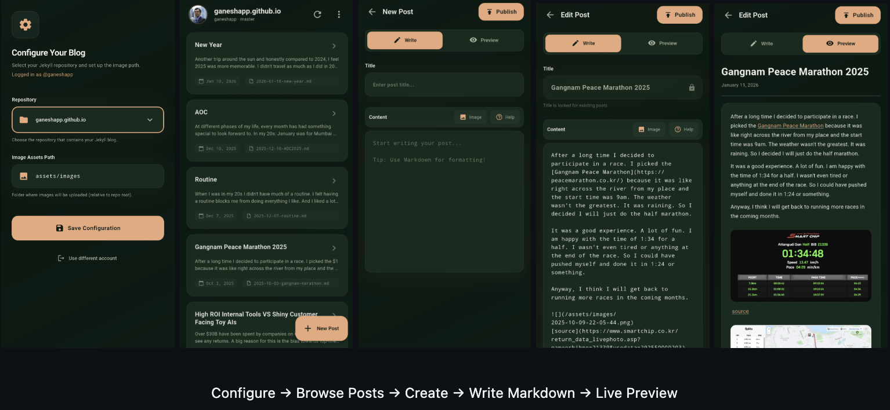

## The Problem

GitHub Pages is arguably the best place to host a developer blog:
* **It's Free:** No hosting costs.
* **It's Fast:** Static site generation via Jekyll.
* **It's Version Controlled:** You own your data forever.

**But the writing experience is terrible, especially on mobile.**

To publish a simple post, you usually have to:
1.  Open a desktop IDE (VS Code / Cursor).
2.  Manually create a file with a specific date format: `2026-01-11-my-post.md`.
3.  Manually type out YAML Frontmatter.
4.  **Images are a nightmare:** You have to put the image in an assets folder, rename it, compress it yourself, and then manually type the relative Markdown path.
5.  Commit, Push, Handle Merge Conflicts.

On mobile, it's even worse. The GitHub mobile app is designed for code review, not prose writing. You have to click through 10 layers of folders just to find `_posts`. Let alone pasting images or putting links in your posts.

## The Solution

**Jekyll Press** is a Flutter app for Android, macOS, and Linux that treats your GitHub repository like a Headless CMS. It abstracts away the Git complexity and gives you a WordPress-like experience.

### Key Features

* **Zero Git Commands:** No `git pull` or `git push`. The app uses the GitHub REST API directly. So there is no bloat and the app is fast and remains small.
* **Mobile-First Editor:** Write in Markdown with a live preview toggle.
* **Automated Frontmatter:** The app handles the dates, titles, and file naming conventions for you.
* **Smart Image Handling:** Pick an image from your gallery.
    * **Auto-Compression:** Resizes to a maximum dimension of 1600 pixels and compresses (JPEG 85%) to save bandwidth.
    * **Privacy:** Strips EXIF metadata (GPS location) before upload.
    * **Auto-Upload:** Uploads to your configured assets folder and inserts the correct Markdown link automatically.
* **Offline Support:** Write drafts on the plane; sync when you land.

## Technical Architecture & Design Choices

I made specific technical trade-offs to keep the app lightweight and fast.

### 1. REST API vs. Git Protocol
* **Decision:** We use the **GitHub REST API** exclusively. We do *not* clone the repository.
* **Why:** A standard `git clone` downloads the entire history of the repository. On a mobile device, this bloats storage and eats data.
* **Trade-off:** We lose the ability to do complex merges.
* **Trade-off in practice:** This is a personal writing tool. An update retries against the latest file version, keeping my edits when a conflict occurs.

### 2. The "Local-First" Image Resolver
* **Problem:** When you add an image in the editor, it takes time to upload. If you are offline, you can't upload it. How do you preview it?
* **Solution:** 1. The app saves a local copy of the compressed image in the app's internal storage.
    2. It maps the filename (e.g., `img_123.jpg`) to the local path in a local database (Hive).
    3. The Markdown Previewer intercepts image requests. It checks: *"Do I have this image locally?"*
        * **Yes:** Load from disk (Instant, works offline).
        * **No:** Load from GitHub Raw URL.

### 3. Read-Only Titles for Existing Posts
* **Decision:** Existing post titles and filenames stay fixed. Post settings let me change the publication date, layout, categories, and tags.
* **Why:** Keeping the filename avoids renaming the source file. Date and category edits can still change a public URL, depending on the site’s permalink settings.
* **Trade-off:** Slightly less flexibility for the user.
* **Benefit:** Routine text edits keep the existing filename.

## Tech Stack

* **Framework:** [Flutter](https://flutter.dev) (Android, macOS, and Linux)
* **State Management:** [Riverpod](https://riverpod.dev)
* **Networking:** [Dio](https://pub.dev/packages/dio) (HTTP client)
* **Local DB:** [Hive](https://docs.hivedb.dev/) (NoSQL for drafts & config)
* **Secure Storage:** [flutter_secure_storage](https://pub.dev/packages/flutter_secure_storage) (For storing GitHub Tokens)

## Download and Repository

Downloads: [Latest JekyllPress release](https://github.com/ganeshapp/JekyllPress/releases/latest)

Github Repo: [Jekyll Press](https://github.com/ganeshapp/jekyllpress)

