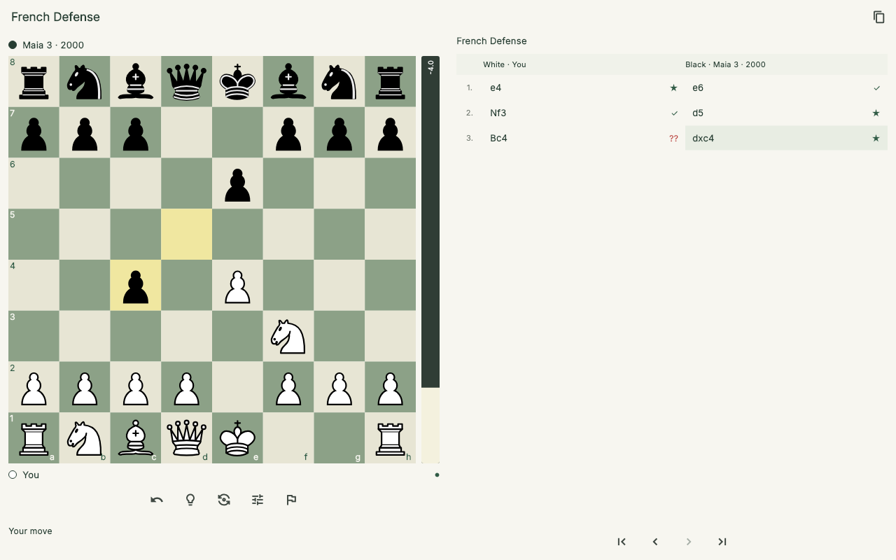
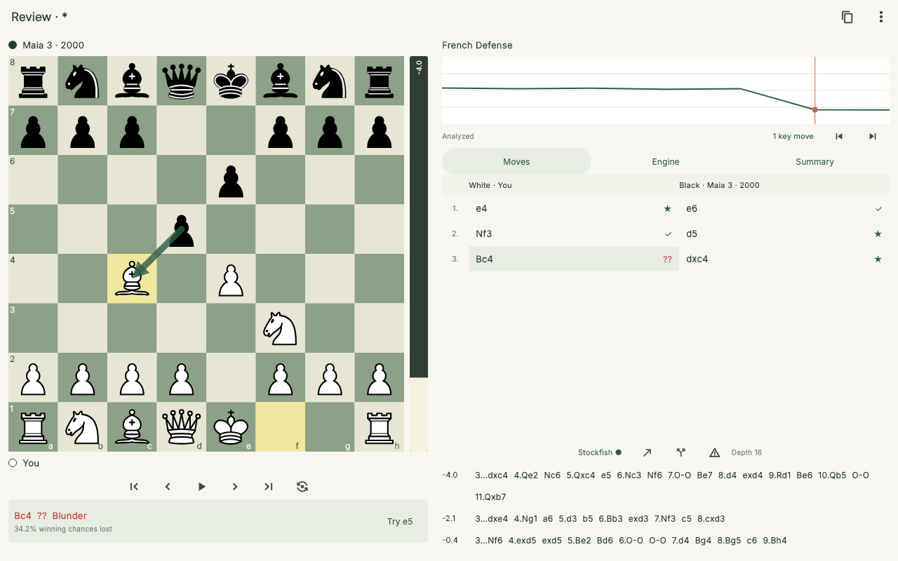
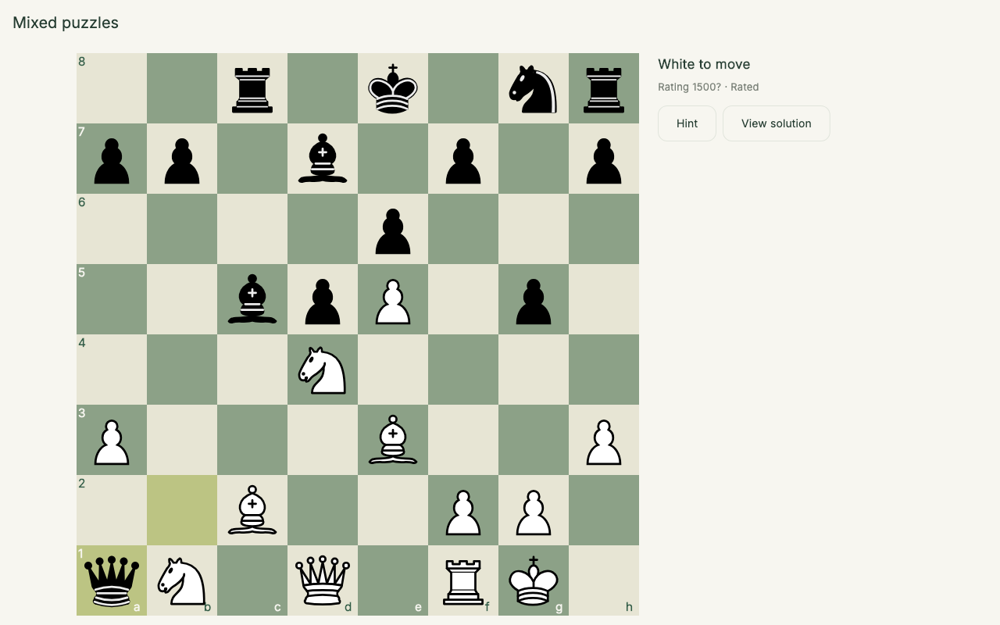

I wanted a chess app I could open, play a game, learn something, and close. No account to manage, no friends list, no reason to share my stats. Just a board and an opponent that felt like a person.

That is where **Tal** started. It is an offline chess trainer for Mac and Android. The opponents, analysis and puzzles are included in the download, and my games and practice history stay on my own device.

[Download Tal](https://github.com/ganeshapp/Tal/releases/latest) · [Source on GitHub](https://github.com/ganeshapp/Tal)

*An example position in the desktop app. The board, players, evaluation and moves share one screen. Click any screenshot to enlarge it.*

## An opponent I can learn from

A very strong engine can show me that a move is wrong. That is useful. But when I am practising an opening or trying to build an attack, I also want to meet the replies another person might actually play: the natural developing move, the tempting capture, the slightly careless defence.

Tal uses [Maia](https://github.com/CSSLab/maia3), a model trained on human games, to choose its opponents' moves. I can select a strength and play at my own pace.

Stockfish handles the analysis. That gives the app two useful perspectives: a human-like opponent to practise against, and a strong engine to help inspect what happened afterward.

I can take back a move, change sides, or practise from a particular opening. An evaluation bar is available when I want feedback during play, and can stay hidden when I want to work things out myself.

## The review should keep me at the board

One of my biggest frustrations with the early version was how much scrolling it took to understand a single move. The board was in one place, the verdict somewhere below it, and the useful suggestion below that. That is a bad arrangement for something I want to do repeatedly.

The review now keeps the board and the selected move's feedback together. I can click a move, jump to a dip in the evaluation graph, step through the game, or let it play automatically. Both sides' moves are there, along with arrows and the computer's suggested continuations.

*The same example game in review, using Stockfish analysis. Selecting a move brings its position and feedback into view together.*

The part I care about most is being able to leave the game for a moment. If I thought a sacrifice might work, I can play it on the analysis board, explore the replies, then return to what actually happened. I want to investigate the idea, not just collect a red mark beside a move.

## Practice that gives me something specific to work on

Sometimes I want a whole game. Sometimes I want ten minutes on a weakness.

Tal includes **19,050 puzzles**. A local puzzle rating moves up or down with first attempts, and helps choose an appropriate difficulty. I can ask for something easier, or deliberately aim 100 or 200 points above my current level.

There is a mixed queue, where I have to recognise the idea for myself, and themed practice for things such as forks, queen sacrifices, discovered attacks, or mate in two and three. A dashboard breaks down my results by theme, including a radar chart, so I can choose what to practise next. These are my own local training ratings, not a leaderboard.

*A puzzle ready to solve. The question mark beside the rating means it is still provisional; this example starts with a fresh practice history.*

For a change of pace, Streak keeps going until the first mistake. Storm is a three- or five-minute run that starts with easier puzzles and gets harder as I solve them.

Opening practice lets me rehearse a line, choose a side, and continue against the bot from that position. Endgame drills provide positions to repeat, and analyzed blunders can return later as practice. The useful loop is small: find a problem, work on it, and meet it again.

## Why make another chess app?

Lichess and Chess.com already offer many of the board controls and analysis tools I want. Tal borrows those familiar ideas. Premoves, takebacks, a navigable move list and a board I can explore are things a chess app should get right.

My reason for making this one is its focus. I want a private practice space that works without a connection, with everything needed already installed. I do not need another place to find opponents or maintain a public profile. I want to play, examine a decision, and try again.

The more interesting difference is where I want it to go.

## Why Tal?

I named it after **Mikhail Tal** because the chess I want to develop is attacking, imaginative and willing to take a justified risk. I want to notice an unusual sacrifice, generate more than one plausible move, and understand how to keep the initiative alive.

The current app is still a general chess trainer. The Tal-specific work is ahead: positions from his games, exercises that ask for several attacking candidates, practice with sacrifices and compensation, and opponents that give me different human responses to the same idea.

I also want the review to ask better questions. What did the sacrifice buy? Could the defender find the necessary reply? Did the attack create lasting pressure, or did it depend on one hopeful trick? An engine score can help answer those questions, but a score alone does not teach me to see the idea in the first place.

That is the direction: **develop creativity and practical attacking judgement**. Keep the analysis honest, while making room to experiment, fail, and discover moves I would otherwise never consider.

## Try it

The current release is **Tal 0.3.0**:

- **[Download for Mac](https://github.com/ganeshapp/Tal/releases/download/v0.3.0/Tal-0.3.0-arm64.dmg)** — Apple Silicon, macOS 12 or later; about 183 MB. Open the DMG and drag Tal into Applications. This early build is locally signed, but not Apple-notarized.
- **[Download for Android](https://github.com/ganeshapp/Tal/releases/download/v0.3.0/Tal-0.3.0-android-arm64.apk)** — ARM64 devices running Android 7 or later; about 232 MB. It is an APK to install directly, rather than a Play Store listing.

Both include the engines and training data. No sign-in or extra download is needed to start practising.

For newer versions, visit the [releases page](https://github.com/ganeshapp/Tal/releases/latest). The [GitHub repository](https://github.com/ganeshapp/Tal) has the source, technical details and roadmap. The app is free and open source.
